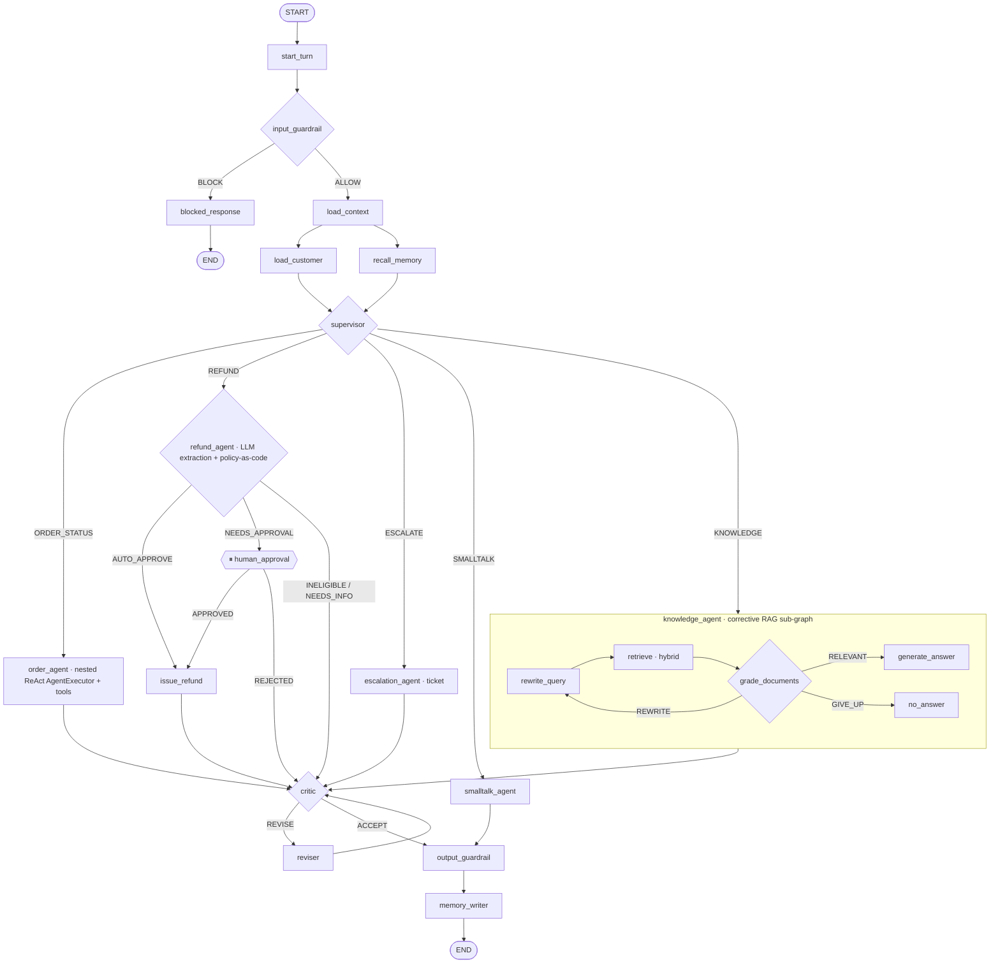

# Acme Support Agent: agentic AI with LangGraph4j, LangChain4j and Spring Boot

A customer-support service for a fictional outdoor-gear retailer. It's built to show a wide range of agentic AI
patterns in one realistic app, run against real infrastructure:

- **Java:** LangGraph4j orchestration, LangChain4j model access, Spring Boot 4
- **Models:** Claude Sonnet 5.5 and Claude Haiku 5.5
- **Storage:** Postgres + pgvector
- **Observability:** OpenTelemetry → Jaeger, Prometheus, Loki and Grafana
- **Debugging:** LangGraph4j Studio



## Agentic concepts and where to find them

| Concept | Where | Notes |
|---|---|---|
| **Stateful graph orchestration** | `graph/SupportGraphFactory` | Nodes, edges, conditional routing, recursion limit |
| **Supervisor / multi-agent routing** | `SupervisorNode`, `ai/IntentRouter` | Structured-output classifier; keyword fallback when confidence is low or the model fails |
| **Specialist agents** | `graph/nodes/*` | Knowledge, orders, refunds, escalation, small talk |
| **ReAct tool-calling agent** | `OrderAgentNode`, `tools/OrderTools` | LangGraph4j's prebuilt `AgentExecutor` runs as a nested graph ("agent as a node") |
| **Tool authorization** | `OrderTools` | Tools are bound to the authenticated customer, so the LLM never supplies a customer id |
| **Agentic / corrective RAG** | `KnowledgeRagSubgraph` | Query rewriting → hybrid search → LLM relevance grading → retry with a new query, or give up honestly |
| **Hybrid retrieval** | `StoreConfig` | pgvector cosine + Postgres full-text, fused with reciprocal rank fusion |
| **Sub-graphs** | `KnowledgeRagSubgraph` | A state sub-graph, flattened into the parent at compile time |
| **Parallel execution** | `load_context` fan-out | Customer profile ∥ memory recall, on virtual threads |
| **Human-in-the-loop** | `HumanApprovalNode`, `interruptBefore` | The run pauses and is persisted; a specialist resumes it hours later via the API, even after a restart |
| **Short-term memory** | `PostgresSaverV2` checkpoints | The whole thread state is stored after every node; `releaseThread(false)` keeps multi-turn chat going |
| **Context-window management** | `MemoryWriterNode` | Older turns are folded into a running summary and the message list is trimmed (`ReplaceAllWith`) |
| **Long-term semantic memory** | `LongTermMemoryService` | Durable facts are extracted each turn, embedded and recalled across conversations (plus a right-to-be-forgotten endpoint) |
| **Reflection / LLM-as-judge** | `CriticNode` ⇄ `ReviserNode` | Groundedness and policy review with a bounded revision budget |
| **Guardrails** | `InputGuardrailNode`, `OutputGuardrailNode` | Layered: deterministic rules → LLM classifier (fails open); output PII redaction and prompt-leak blocking |
| **Policy-as-code** | `RefundPolicyService` | The LLM extracts the request; code decides whether money moves |
| **Idempotent side effects** | `SupportRepository.recordRefund` | Retries and replays can never pay twice |
| **Resilience** | `RetryPolicy` node hooks | Exponential back-off on rate limits, timeouts and malformed output; graceful degradation everywhere |
| **Model routing (cost-aware)** | `AiModelConfig` | Sonnet 5.5 for reasoning, Haiku 5.5 for classification and extraction |
| **Prompt caching** | `AiModelConfig` | Anthropic caching of system prompts and tool definitions |
| **Structured outputs** | `ai/*` | Typed LangChain4j AiServices returning records and enums via JSON schema |
| **Streaming** | `/messages/stream` | Server-Sent Events, one event per executed node |
| **Time travel** | `/history` | Every checkpoint of a thread |
| **Observability** | `observability/*` | Spans per node, LLM call and tool call; GenAI semantic conventions; token and latency metrics; business metrics; correlated logs |
| **Visual debugging** | LangGraph4j Studio | Step through the graph, edit state, resume interrupts |

## Quick start

Prerequisites: Java 25 (LTS), Docker, and an Anthropic API key.

```bash
docker compose up -d                       # Postgres/pgvector, OTel collector, Jaeger, Prometheus, Loki, Grafana
export ANTHROPIC_API_KEY=sk-ant-...
./mvnw spring-boot:run
```

On first start the app creates its tables, seeds three customers with their orders, and embeds the knowledge base
in `src/main/resources/knowledge`. Embeddings run in-process (all-MiniLM-L6-v2), so no embedding API is needed.

Work through the scenarios in **`demo.http`**: RAG, a follow-up question, order lookup, a refund that needs
approval, the approval itself, a blocked injection attempt, escalation, streaming, and memory across conversations.
Or with curl:

```bash
T=$(curl -s localhost:8080/api/conversations -H 'content-type: application/json' \
      -d '{"customerId":"C-1002"}' | jq -r .threadId)

curl -s localhost:8080/api/conversations/$T/messages -H 'content-type: application/json' \
     -d '{"message":"The ultralight tent leaks, I want a refund"}' | jq
# → "status": "AWAITING_APPROVAL"   ($343.04 is over the $100 auto-approve limit)

curl -s localhost:8080/api/approvals | jq
curl -s localhost:8080/api/conversations/$T/approval -H 'content-type: application/json' \
     -d '{"approved":true,"approver":"dana@acme.example"}' | jq
```

Every response includes a `traceId` (paste it into Jaeger) and an `agentTrace` listing what each node decided.

### Seed data

| Customer | Tier | Interesting orders |
|---|---|---|
| `C-1001` Alice | GOLD | `A-5001` delivered, $64.90 (small refund, auto-approved) · `A-5002` in transit |
| `C-1002` Bob | STANDARD | `A-5003` tent, $349.99 (needs human approval) · `A-5004` delivered 66 days ago (outside the return window) |
| `C-1003` Carol | PLATINUM | `A-5005` processing (free cancellation) · `A-5006` includes a final-sale item |

## LangGraph4j Studio

Open **http://localhost:8080/?instance=support** and enter `customer_id` (for example `C-1002`) and a message.

Studio draws the full graph, including the flattened RAG sub-graph and the parallel branch. You can:

- step through a run and inspect the state at each checkpoint
- edit any value in the state
- resume after the `human_approval` interrupt: set `approval_decision` to `APPROVED` and `approver` to a name,
  then continue

Studio threads use an in-memory checkpoint saver, so they stay separate from real conversations. They still call
the real model, database and tools.

## Observability

| UI | URL | What to look at |
|---|---|---|
| Jaeger | http://localhost:16686 | Service `support-agent`: one trace per request, `POST /api/...` → `support.<node>` → `chat claude-…` / `execute_tool …` / SQL |
| Grafana | http://localhost:3000 | Dashboard **Support Agent – LLM & Graph Observability**: tokens by model, LLM latency, node latency, routes, guardrail blocks, critic verdicts, refunds, HITL events, logs |
| Prometheus | http://localhost:9090 | Raw metrics (`gen_ai_client_*`, `agent_*`) |

How the pieces fit:

- **Pipeline.** Spring Boot 4's `spring-boot-starter-opentelemetry` exports traces, metrics and logs over OTLP to
  the collector. The collector fans out to Jaeger, Prometheus and Loki.
- **Graph node spans.** `GraphTracingHook` is a LangGraph4j `NodeHook.WrapCall`, so every node becomes a span and
  a timer. Span attributes include node id, thread id and customer id.
- **LLM call spans.** `LlmTelemetryListener` is a LangChain4j `ChatModelListener` emitting CLIENT spans with
  `gen_ai.*` attributes (model, token usage, finish reasons, tool calls). It also records the
  `gen_ai.client.token.usage` and `gen_ai.client.operation.duration` metrics, tagged with the model tier.
- **Context propagation.** The graph runs on its own threads. The executors are wrapped with
  `Context.taskWrapping`, so node, nested-agent and parallel-branch spans stay in the caller's trace.
- **Logs.** Logs carry `traceId`/`spanId` and are exported via the OTel Logback appender. In Grafana you can jump
  from a log line to its trace.
- **Prompt content.** For demo purposes, truncated prompt and response text is attached to LLM spans as events.
  Turn this off (`agent.observability.capture-content: false`) or redact it in the collector before production use.

## Configuration

All settings live under `agent.*` in `application.yml`:

| Property | Default | Meaning |
|---|---|---|
| `agent.provider` | `anthropic` | `anthropic` or `ollama` (offline) |
| `agent.anthropic.smart-model` / `fast-model` | `claude-sonnet-5-5` / `claude-haiku-5-5` | Model routing tiers |
| `agent.anthropic.prompt-caching` | `true` | Cache system prompts and tool definitions |
| `agent.refund.auto-approve-limit` | `100.00` | Refunds above this pause for human approval |
| `agent.reflection.max-revisions` | `2` | Upper bound on critic → reviser loops |
| `agent.rag.max-results` / `max-query-rewrites` | `5` / `2` | Retrieval breadth and corrective retries |
| `agent.memory.summarize-after-messages` | `16` | When to compact the thread into a summary |
| `agent.studio.enabled` | `true` | Serve LangGraph4j Studio |
| `agent.observability.capture-content` | `true` | Attach truncated prompts and responses to LLM spans (demo only) |

**Offline mode:** run `docker compose --profile ollama up -d`, then `SPRING_PROFILES_ACTIVE=ollama ./mvnw spring-boot:run`.
Expect noticeably weaker tool calling and structured output from small local models. On macOS, run Ollama natively,
because Docker there has no GPU access.

**Containerised app:** `ANTHROPIC_API_KEY=... docker compose --profile app up -d --build`.

## API

| Method | Path | Purpose |
|---|---|---|
| POST | `/api/conversations` | Start a thread for a customer |
| POST | `/api/conversations/{id}/messages` | Send a message and get the answer |
| POST | `/api/conversations/{id}/messages/stream` | Same, as Server-Sent Events |
| GET | `/api/conversations/{id}` | Messages, summary and approval status |
| GET | `/api/conversations/{id}/history` | Checkpoint history |
| GET | `/api/approvals` | Refunds waiting for a specialist |
| POST | `/api/conversations/{id}/approval` | Approve or reject, then resume the graph |
| DELETE | `/api/customers/{id}/memory` | Delete the customer's long-term memory |
| GET | `/api/graph` | The graph as Mermaid |

## Project layout

```
src/main/java/com/acme/support
├── ai/              LangChain4j AiServices: typed prompts with structured outputs
├── api/             REST controller and application service (run / stream / resume / inspect)
├── config/          Models (model routing, caching), vector stores, checkpoint saver, Studio, properties
├── domain/          Repository and policy-as-code (refund rules)
├── graph/           State schema, graph factory, RAG sub-graph
│   └── nodes/       One class per graph node
├── knowledge/       Idempotent RAG ingestion
├── memory/          Long-term semantic memory
├── observability/   Node tracing hook, LLM telemetry listener, business metrics
└── tools/           Customer-scoped tools for the ReAct agent
docker/              Collector, Prometheus and Grafana provisioning (datasources and dashboard)
```

## Production notes (simplifications made for the demo)

- **Authentication.** The customer id is fixed when a conversation starts. A real system takes it from the
  authenticated principal, and protects the approval endpoints with a specialist role.
- **Concurrency.** Two messages sent concurrently on the same thread race on the checkpoint. Serialise per thread
  (for example with a lock or a queue).
- **Latency.** Memory extraction runs inline at the end of each turn. Moving it to an async worker would cut
  response time.
- **Data retention.** Checkpoints store the full conversation in JSONB. Plan retention and encryption accordingly.
- **Evaluation.** Before changing prompts or models, add an offline evaluation set covering routing accuracy, RAG
  groundedness and refund decisions.

## Versions

LangGraph4j 1.9.10 · LangChain4j 1.23.0 · Spring Boot 4.1.1 · Java 25 · Claude Sonnet 5.5 / Haiku 5.5
